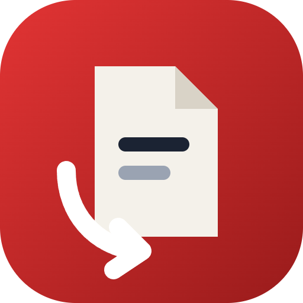
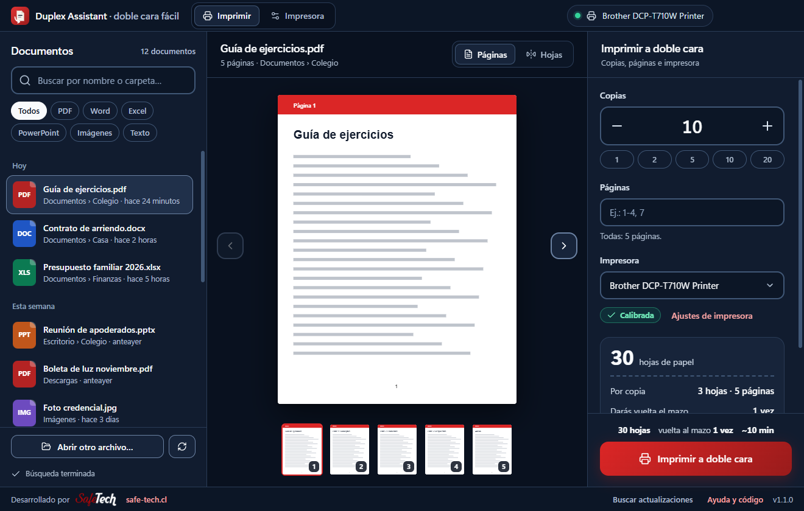
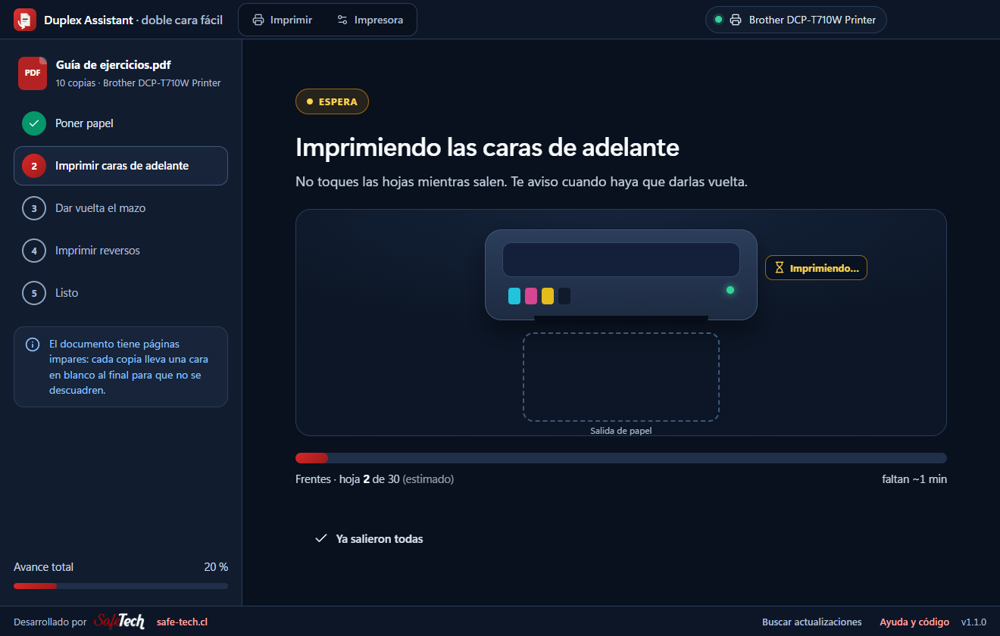
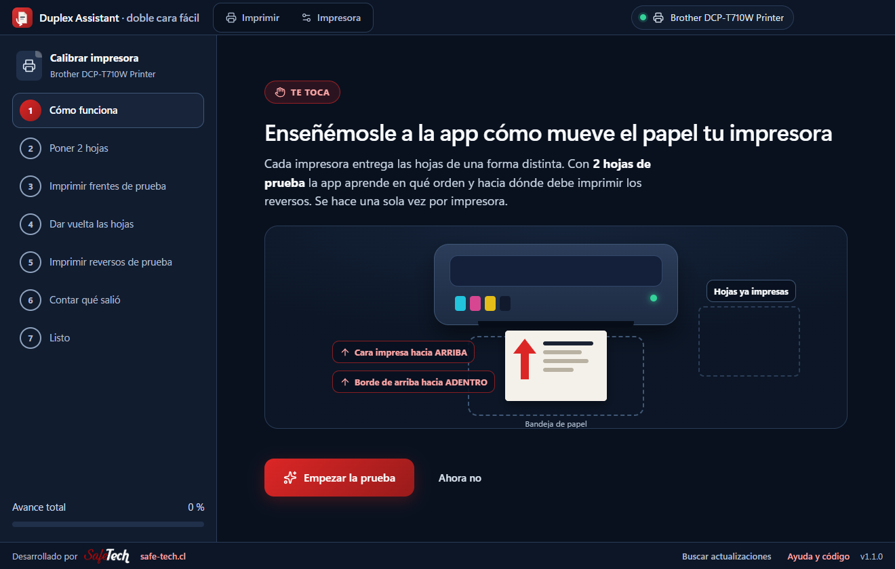
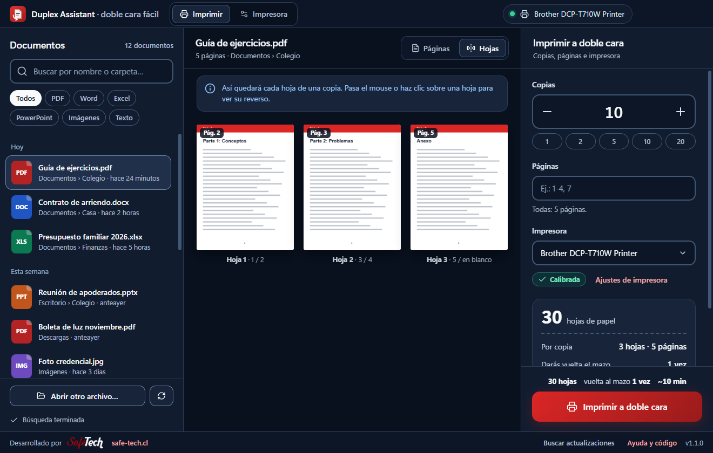
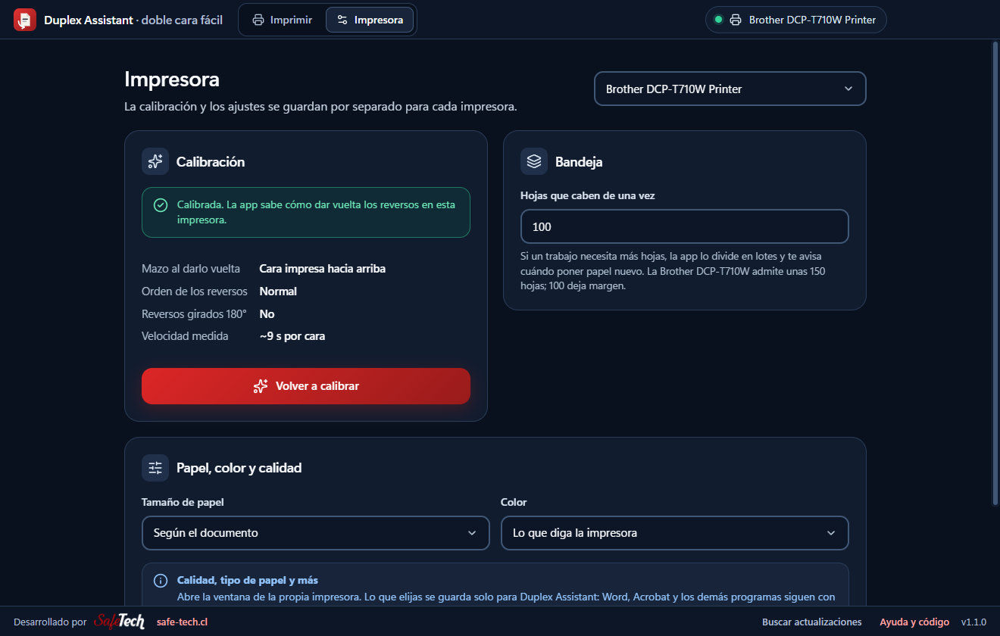

<p align="center"></p>

<h1 align="center">Duplex Assistant</h1>
<p align="center"><b>Imprime a doble cara en impresoras sin dúplex automático.</b><br>
Windows y Linux · Desarrollado por <a href="https://safe-tech.cl">SafeTech</a></p>

<p align="center"></p>

¿Tu impresora (por ejemplo una **Brother DCP-T710W**) no imprime por los dos lados? Duplex Assistant imprime las caras de adelante de **todas** las copias, te avisa cuándo dar vuelta el mazo **una sola vez** y luego imprime los reversos en el orden exacto. No hay que dar vuelta hoja por hoja ni pensar en impares y pares.

## Qué hace

- **Encuentra tus documentos solo**: busca en Escritorio, Documentos, Descargas e Imágenes (también OneDrive) y los ordena por fecha. Puedes filtrar por tipo, escribir el nombre, abrir otro archivo o arrastrarlo a la ventana.
- **Acepta casi cualquier archivo**: PDF, Word, Excel, PowerPoint (con Microsoft Office o LibreOffice), OpenDocument, imágenes, texto y HTML.
- **Vista previa antes de gastar papel**: páginas con miniaturas y una vista **Hojas** que simula cada hoja; pasas el mouse por encima y la hoja se da vuelta para mostrar su reverso.
- **Calibración visual**: con 2 hojas de prueba aprende cómo tu impresora entrega y recibe el papel (orden de los reversos, giro de 180° y lado de impresión). Se hace una vez por impresora.
- **Un paso a la vez**: cada pantalla dice si te toca actuar (rojo), si hay que esperar (ámbar) o si está listo (verde). Incluye animaciones de qué hacer con el papel y barras de progreso con tiempo estimado. El tiempo se ajusta solo según la velocidad real de tu impresora.
- **Lotes según la bandeja**: si el trabajo necesita más hojas de las que caben, lo divide y te avisa cuándo poner papel nuevo.
- **Páginas impares sin descuadres**: agrega una cara en blanco al final de cada copia cuando hace falta.
- **Ajustes propios de impresora**:
  - En Windows, abre la ventana del driver (calidad, tipo de papel…) y guarda esos ajustes **solo para esta app**.
  - En Linux, muestra las opciones CUPS de la impresora.
- **Si se atasca el papel**: puedes repetir los frentes del lote.

| Dar vuelta el mazo | Calibración |
|---|---|
|  |  |
| **Simulación de hojas** | **Ajustes de impresora** |
|  |  |

## Instalar

### Windows 10/11

En **PowerShell**:

```powershell
irm https://raw.githubusercontent.com/psgonzalogr/duplex-assistant/main/install.ps1 | iex
```

Instala solo para tu usuario (no pide administrador) y deja accesos directos en el Escritorio y en Inicio. También puedes descargar `Duplex-Assistant-Setup-x.y.z.exe` desde [Releases](https://github.com/psgonzalogr/duplex-assistant/releases/latest).

> Como el instalador no está firmado, Windows SmartScreen puede mostrar «Windows protegió su PC». Elige **Más información → Ejecutar de todas formas**.

### Linux (CachyOS, Arch, Ubuntu, Fedora…)

En la **terminal**:

```bash
curl -fsSL https://raw.githubusercontent.com/psgonzalogr/duplex-assistant/main/install.sh | bash
```

Lo instala en `~/.local/opt/duplex-assistant` y crea la entrada en el menú de aplicaciones y el comando `duplex-assistant`. Necesita **CUPS** con tu impresora configurada. Para documentos de Office necesita **LibreOffice** (`sudo pacman -S libreoffice-fresh`).

Para desinstalar:

```bash
curl -fsSL https://raw.githubusercontent.com/psgonzalogr/duplex-assistant/main/install.sh | bash -s -- --uninstall
```

Si prefieres hacerlo a mano, descarga el `.AppImage` desde [Releases](https://github.com/psgonzalogr/duplex-assistant/releases/latest), dale permiso de ejecución con `chmod +x` y ábrelo. Si tu sistema no tiene FUSE 2 (`fuse2` / `libfuse2t64`), ejecútalo con `APPIMAGE_EXTRACT_AND_RUN=1`.

## Cómo se usa

1. Elige el documento en la lista de la izquierda o arrástralo a la ventana.
2. Indica cuántas copias quieres y, si hace falta, qué páginas (por ejemplo `1-4, 7`).
3. La primera vez aprieta **Calibrar impresora**: son 2 hojas y un minuto.
4. Aprieta **Imprimir a doble cara** y sigue lo que indica cada paso. En la mitad del trabajo tomas el mazo y lo vuelves a poner como muestra la animación.

## Desarrollo

```bash
npm install
npm run dev          # compila la interfaz y abre la app
npm test             # pruebas del motor de orden de páginas
npm run selftest     # recorre todas las pantallas con una impresora simulada y guarda capturas en selftest-out/
npm run dist:win     # instalador .exe (en Windows)
npm run dist:linux   # AppImage (en Linux)
```

Cada etiqueta `vX.Y.Z` compila el `.exe` y el `.AppImage` en GitHub Actions y los publica en Releases.

Estructura:

- `src/main/`: proceso principal de Electron.
  - `compose.js`: orden de las hojas, con pdf-lib.
  - `convert.js`: cualquier archivo a PDF.
  - `scanner.js`: buscador de documentos.
  - `printing/`: impresión con SumatraPDF en Windows y CUPS en Linux.
- `src/renderer/`: interfaz en JS sin framework, compilada con Vite.
  - `views/`: pantallas.
  - `flow.js`: asistente por pasos.
  - `scenes.js`: animaciones.

## Licencia

MIT © [SafeTech](https://safe-tech.cl). Incluye SumatraPDF (GPLv3, solo en Windows), pdf.js, pdf-lib, Inter y Lucide; los detalles están en [LICENSE](LICENSE).
